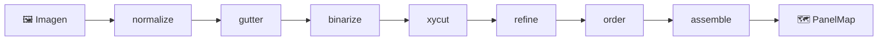
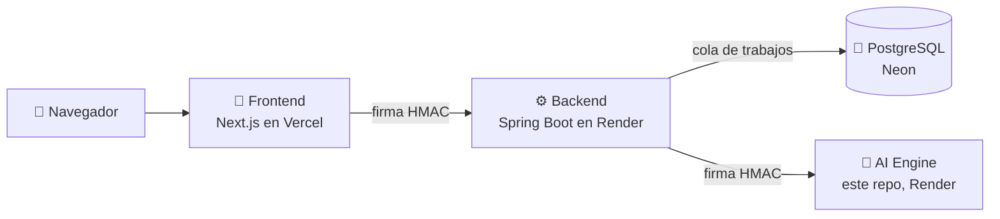

# 🧠 PanelVault · AI Engine

> **Motor de visión por computador** que recibe una página de cómic y devuelve el **mapa de viñetas** en **orden de lectura**, para cómic occidental (izquierda → derecha) y para manga (derecha → izquierda).


| | |
|---|---|
| 👨‍💻 **Desarrollado por** | David Fernando Ramírez de la Parra |
| 👨‍🏫 **Profesor** | Jhonatan Andrés Mideros Narváez |
| 📚 **Asignatura** | Programación Orientada a la Web |
| 🏛️ **Institución** | Universidad Cooperativa de Colombia |

---

## 📑 Contenido

1. [El caso de estudio](#-el-caso-de-estudio)
2. [Qué hace este motor](#-qué-hace-este-motor)
3. [Por qué esta IA y no otra](#-por-qué-esta-ia-y-no-otra)
4. [Cómo funciona el algoritmo](#-cómo-funciona-el-algoritmo)
5. [Cumplimiento del caso de estudio](#-cumplimiento-del-caso-de-estudio)
6. [Resultados medidos](#-resultados-medidos)
7. [Arquitectura del código](#-arquitectura-del-código)
8. [Cómo encaja en PanelVault](#-cómo-encaja-en-panelvault)
9. [API](#-api)
10. [Seguridad](#-seguridad)
11. [Ejecutar en local](#-ejecutar-en-local)
12. [Variables de entorno](#-variables-de-entorno)
13. [Pruebas y calidad](#-pruebas-y-calidad)
14. [Docker y despliegue](#-docker-y-despliegue)
15. [Limitaciones conocidas](#-limitaciones-conocidas)

---

## 📖 El caso de estudio

**Caso de estudio 1: Gestor de Cómics Digitales Offline-First con Análisis Visual Inteligente.**

PanelVault es una plataforma web para leer, organizar y gestionar cómics digitales y novelas gráficas. La inteligencia artificial es **co-protagonista**: un **sistema de visión por computador para segmentación de objetos y detección de bordes, ubicado en el servidor**, que convierte una imagen estática en una lectura guiada **viñeta por viñeta**.

PanelVault está dividido en **tres repositorios independientes**:

| Repositorio | Rol |
|---|---|
| 🎨 [`panelvault-frontend`](https://github.com/dramirezdlp99/panelvault-frontend) | Interfaz web (Next.js), offline-first |
| ⚙️ [`panelvault-backend`](https://github.com/dramirezdlp99/panelvault-backend) | API, seguridad, cola de análisis y datos (Spring Boot) |
| 🧠 **`panelvault-ai-engine`** (este) | Visión por computador (Python + OpenCV) |

---

## 🎯 Qué hace este motor

Recibe los bytes de una imagen (JPEG, PNG o WebP) y responde:

- 📐 **Dónde está cada viñeta**: un rectángulo `[x, y, ancho, alto]` y su polígono, con coordenadas **relativas** de 0 a 1. Así sirven para la imagen original aunque se haya reducido antes de enviarla.
- 🔢 **En qué orden se lee** (`order`, empezando en 0): occidental (`ltr`) o manga (`rtl`), según el *preset*.
- 📊 **Con qué confianza**: por viñeta y por página.
- ⏱️ **Cuánto tardó cada etapa**, para poder medir y optimizar.

```json
{
  "engineVersion": "0.1.0",
  "preset": "western",
  "imageWidth": 1200,
  "imageHeight": 1800,
  "elapsedMs": 84.2,
  "stages": { "normalize": 3.1, "gutter": 1.2, "binarize": 6.8, "xycut": 41.0, "refine": 9.4, "order": 0.3, "assemble": 0.7 },
  "panelMap": {
    "schemaVersion": 1,
    "direction": "ltr",
    "pageType": "grid",
    "confidence": 0.9912,
    "panels": [
      { "order": 0, "confidence": 1.0, "bbox": [0.05, 0.033333, 0.444167, 0.298889], "polygon": [[0.05, 0.033333], [0.494167, 0.033333], [0.494167, 0.332222], [0.05, 0.332222]] }
    ]
  }
}
```

---

## 🤔 Por qué esta IA y no otra

Es **inteligencia artificial clásica**: **visión por computador** con **OpenCV y NumPy**. No es un modelo de *machine learning* entrenado, sino un **algoritmo diseñado** que analiza la matriz de la imagen paso a paso.

| Criterio | Visión por computador clásica (elegida) | Red neuronal (descartada) |
|---|---|---|
| 💰 Costo | Gratis, corre en CPU | Necesita GPU o un servicio de pago |
| 📦 Datos | No necesita entrenamiento | Miles de páginas anotadas a mano, con derechos de autor |
| 🔍 Explicable | Cada corte se puede justificar | "Caja negra" |
| 🎯 Determinista | La misma página da siempre el mismo resultado | Puede variar |
| ⚡ Velocidad | Menos de un segundo por página | Mucho más lenta en CPU |
| 🧮 Memoria | ~170 MB con páginas de 13 MP, ~220 MB con 24 MP | No cabe en 512 MB |

> 💡 **La decisión se tomó con datos**: la memoria y los tiempos se midieron, no se supusieron. Por eso el motor cabe en el plan gratuito de Render (512 MB).

---

## ⚙️ Cómo funciona el algoritmo

El análisis es un **pipeline de etapas** (patrón *Pipeline* + *Registry*). Cada etapa recibe un contexto, hace una sola cosa y deja su resultado para la siguiente:



| # | Etapa | Qué hace, en simple |
|---|---|---|
| 1 | `normalize` | Lleva cualquier página a escala de grises y a un tamaño de trabajo uniforme |
| 2 | `gutter` | Estima el color del **medianil** (el espacio entre viñetas) mirando los márgenes. Funciona con fondo blanco **o negro** |
| 3 | `binarize` | Separa el "dibujo" del "medianil" en una matriz de ceros y unos |
| 4 | `xycut` (+ `cut_tree`) | **XY-Cut recursivo**, el núcleo: busca franjas de medianil que crucen la página de lado a lado, corta, y repite en cada pedazo. El resultado es un **árbol de cortes** |
| 5 | `refine` | Divide viñetas que quedaron fusionadas por medianiles demasiado delgados |
| 6 | `order` | Recorre el árbol para dar el **orden de lectura**: izquierda → derecha (`western`) o derecha → izquierda (`manga`) |
| 7 | `assemble` | Filtra candidatas falsas (muy pequeñas o vacías) y arma el mapa final con su confianza |

**Por qué un árbol:** cada corte divide la página en dos o más partes; recorrer el árbol en orden produce exactamente la secuencia en que una persona lee la página.

---

## ✅ Cumplimiento del caso de estudio

Sección **1.3 · Funcionamiento a fondo de la IA**:

| Requisito | Estado | Dónde |
|---|---|---|
| Visión por computador para segmentación y detección de bordes **en el servidor** | ✅ | Este repositorio, desplegado en Render |
| 1. Al cargar una página, el servidor analiza la **matriz de la imagen** | ✅ | `normalize` + `binarize` (NumPy/OpenCV) |
| 2. Escanea los márgenes y calcula la **geometría exacta** de cada viñeta | ✅ | `gutter` + `xycut` + `refine` |
| 3. Genera un **mapa de coordenadas** con la **secuencia lógica de lectura** | ✅ | `order` + `assemble` → `PanelMap` |
| 4. **Lectura guiada**: el visor hace zoom viñeta por viñeta | ✅ | Lo consume `panelvault-frontend` (modo "Viñeta por viñeta") |

---

## 📊 Resultados medidos

Con el generador de **páginas sintéticas** (`panelvault-ai evaluate --seeds 10`, 70 páginas cuya respuesta correcta se conoce):

| Categoría | Páginas | Perfectas | Precisión | Recall | F1 | IoU | Orden (τ) |
|---|---|---|---|---|---|---|---|
| Filas, fondo blanco | 10 | 10 | 1.000 | 1.000 | 1.000 | 0.972 | 1.000 |
| Filas, fondo negro | 10 | 10 | 1.000 | 1.000 | 1.000 | 0.972 | 1.000 |
| Filas con ruido (escaneo) | 10 | 10 | 1.000 | 1.000 | 1.000 | 0.972 | 1.000 |
| Medianil delgado | 10 | 10 | 1.000 | 1.000 | 1.000 | 0.973 | 1.000 |
| Manga | 10 | 10 | 1.000 | 1.000 | 1.000 | 0.976 | 1.000 |
| ⚠️ Límite: molinete | 10 | 0 | 0.429 | 0.600 | 0.500 | 0.978 | 1.000 |
| ⚠️ Límite: viñetas pegadas | 10 | 0 | 0.000 | 0.000 | 0.000 | — | — |

- **Precisión:** de lo que detectó, cuánto era una viñeta real.
- **Recall:** de las viñetas reales, cuántas encontró.
- **IoU:** qué tanto coincide el rectángulo detectado con el real.
- **τ (Kendall):** qué tan correcto es el orden de lectura (1.000 = perfecto).

Las dos últimas categorías se incluyen **a propósito** como límites conocidos del método (ver [Limitaciones](#-limitaciones-conocidas)).

Además, las 25 páginas del **kit de prueba** del proyecto (CBZ occidental, CBZ manga, PDF e imágenes sueltas) se detectan **todas** con el número correcto de viñetas y en el orden correcto.

---

## 🏗️ Arquitectura del código

Orientada a objetos, con responsabilidades separadas:

```
src/panelvault_ai/
├── domain/        🧱 Modelos inmutables: Rect, Panel, PanelMap (geometría pura)
├── pipeline/      🔗 Contexto, interfaz Stage, registro de etapas, modo depuración
├── stages/        🧩 Una clase por etapa (normalize, gutter, binarize, xycut, refine, ordering, assemble)
├── analyzer.py    🎛️ Fachada: arma el pipeline según el preset (western / manga)
├── api/           🌐 FastAPI, verificación HMAC y configuración por entorno
├── synthetic/     🧪 Generador de páginas sintéticas con su respuesta correcta
├── evaluation/    📏 Métricas (precisión, recall, IoU, orden) y benchmark
└── cli.py         💻 Línea de comandos: demo, analyze, evaluate, request
```

**Patrones de diseño:** Pipeline, Registry (registro de etapas), Strategy (presets de lectura), Facade (`PanelAnalyzer`), Value Object (geometría inmutable), Factory (`create_app`) y Composite (árbol de cortes).

---

## 🔗 Cómo encaja en PanelVault



- **Solo el backend** llama a este motor, nunca el navegador.
- Las páginas llegan por una **cola de trabajos** (capa asíncrona del backend), así la API nunca espera a la IA.
- El backend guarda el resultado **por huella SHA-256** de la imagen: la misma página **nunca se analiza dos veces**.
- `GET /health` no pide firma: el backend lo usa para **"despertar"** el servicio, porque en el plan gratuito se duerme tras 15 minutos sin uso.

---

## 🌐 API

### `GET /health`

```json
{ "status": "ok", "version": "0.1.0", "presets": ["manga", "western"] }
```

### `POST /v1/analyze?preset=western|manga`

| Parte | Detalle |
|---|---|
| Cuerpo | Bytes crudos de la imagen (JPEG, PNG o WebP), `Content-Type: application/octet-stream` |
| Cabeceras | `X-PanelVault-Timestamp` y `X-PanelVault-Signature` |
| Firma | HMAC-SHA256 de `timestamp\nMÉTODO\nruta\nsha256(cuerpo)` (la ruta sin la query) |

| Código | Significado |
|---|---|
| `200` | Mapa de viñetas |
| `401` | Firma inválida o vencida |
| `413` | Imagen demasiado grande |
| `422` | Imagen o preset no válidos |

> La documentación interactiva (`/docs`, `/redoc`, `/openapi.json`) está **apagada por defecto** y solo se enciende en local con `PANELVAULT_ENABLE_DOCS=true`.

---

## 🔐 Seguridad

- 🔏 **Firma HMAC** con comparación en tiempo constante y **ventana de validez** (anti-repetición).
- 📏 **Límite de tamaño** antes de procesar y **límite de píxeles** al decodificar (evita "bombas" de descompresión).
- 🚫 El servidor **se niega a arrancar** si falta el secreto o es demasiado corto.
- 📕 Documentación interactiva **apagada** en producción.
- 👤 La imagen Docker corre con un **usuario sin privilegios**.
- 🔑 **Ningún secreto en el repositorio**: todo por variables de entorno.

---

## 💻 Ejecutar en local

**Requisitos:** Python 3.12 o superior.

```powershell
python -m venv .venv
.venv\Scripts\Activate.ps1
pip install -e ".[dev]"
```

**Comandos útiles:**

```powershell
panelvault-ai demo                                    # genera una página sintética y la analiza
panelvault-ai analyze pagina.jpg --preset manga --debug
panelvault-ai evaluate --seeds 50                     # mide precisión, recall y orden
```

**Levantar la API:**

```powershell
$env:PANELVAULT_ENGINE_SECRET = "el-mismo-valor-que-usa-el-backend"
$env:PANELVAULT_ENABLE_DOCS = "true"
uvicorn panelvault_ai.api.app:create_app --factory --port 8001
```

- ❤️ Salud: <http://127.0.0.1:8001/health>
- 📕 Documentación: <http://127.0.0.1:8001/docs>
- 🧪 Petición firmada igual que el backend: `panelvault-ai request pagina.jpg --url http://127.0.0.1:8001 --preset western`

---

## 🔧 Variables de entorno

| Variable | Obligatoria | Por defecto | Descripción |
|---|---|---|---|
| `PANELVAULT_ENGINE_SECRET` | ✅ Sí | — | Secreto HMAC compartido con el backend (mínimo 32 caracteres) |
| `PANELVAULT_ENABLE_DOCS` | No | `false` | Activa `/docs`, `/redoc` y `/openapi.json` |
| `PANELVAULT_MAX_UPLOAD_BYTES` | No | `15728640` | Tamaño máximo de imagen (15 MiB) |
| `PANELVAULT_MAX_PIXELS` | No | `40000000` | Máximo de píxeles por imagen |
| `PANELVAULT_SIGNATURE_TTL` | No | `300` | Segundos de validez de una firma |
| `PORT` | No | `8001` | Puerto en Docker (Render lo inyecta solo) |

Ver `.env.example`. Ningún secreto real se sube a Git.

---

## 🧪 Pruebas y calidad

```powershell
python -m pytest -q          # 228 pruebas
ruff check src tests          # estilo y errores
ruff format --check src tests # formato
```

Las pruebas cubren:

- 🧱 Geometría y modelos del dominio.
- 🧩 Cada etapa del pipeline por separado.
- 🔢 Orden de lectura occidental y manga.
- 🧪 Páginas sintéticas de todas las categorías, incluidos los límites conocidos.
- 🔏 Firma HMAC, ventana de tiempo y rechazo de peticiones manipuladas.
- 🌐 La API completa (200, 401, 413, 422, documentación apagada).
- 🤝 **Compatibilidad con el backend:** las pruebas de `panelvault-backend` comparan su firma HMAC con la que calcula este motor, así ambos lados firman exactamente igual.

---

## 🐳 Docker y despliegue

```powershell
docker build -t panelvault-ai .
docker run --rm -p 8001:8001 -e PANELVAULT_ENGINE_SECRET=... panelvault-ai
```

**Render (plan gratuito):**

1. *New → Web Service* desde este repositorio, con **Docker**.
2. Variable `PANELVAULT_ENGINE_SECRET` en *Environment*.
3. *Health Check Path*: `/health`.

El backend apunta a la URL pública de este servicio con su variable `PANELVAULT_ENGINE_URL`.

---

## ⚠️ Limitaciones conocidas

Documentadas y cubiertas por pruebas, para no inflar lo que hace el motor:

- 🌀 **Composición en "molinete":** cuatro viñetas giran alrededor de una central y ningún medianil cruza la página de lado a lado. Un algoritmo de cortes rectos (XY-Cut) no puede separarla.
- 🧲 **Viñetas pegadas:** sin espacio entre ellas, no hay medianil que detectar.
- 🎨 **Viñetas sin borde o dibujos que se salen del cuadro:** pueden reducir la precisión.

**Mejora futura posible:** combinar el XY-Cut con detección de contornos (`findContours`) para las páginas donde no existe un corte recto.

---

<p align="center">
🧠 <b>PanelVault AI Engine</b> · Caso de estudio 1 · Programación Orientada a la Web<br/>
David Fernando Ramírez de la Parra · Universidad Cooperativa de Colombia
</p>
